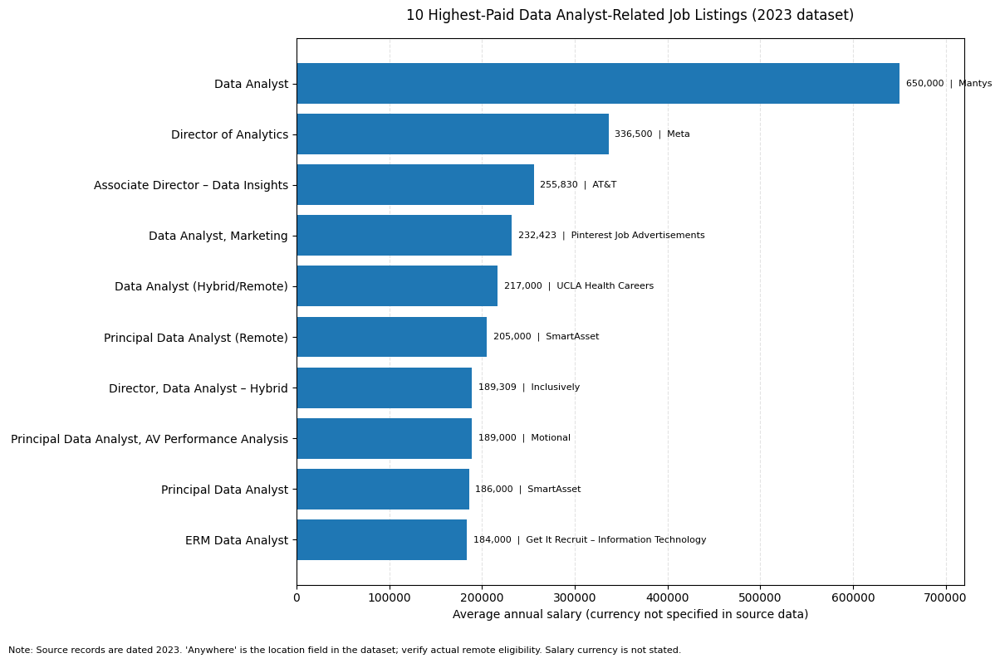

# Introduction
This job market dataset let us understand how the job market of 'Data Analyst' in particular is shaped. I made a few queries to find out whare are the most paying jobs, in demand skills and different salaries.
Check it out: [SQL_Project folder](/SQL_Project)

# Questions I wanted to answer through my queries:

1. What is the top paying job?
2. What skills are required?
3. What skills are the most in demand for 'Data Analyst'?
4. Which skills are associated with higher salaries?
5. What are the best skills to learn first?

# Tools used:
**SQL**, **PostgreSQL**, **VSC**

# The Analysis:

### 1. Top paying jobs:
I filtered 'Data Analyst' positions by avg yearly salary and location (remote). The query shows the top paying jobs.

```sql
Select
    job_id,
    job_title,
    job_location,
    job_schedule_type,
    salary_year_avg,
    job_posted_date,
    name as company_name
FROM
    job_postings_fact
LEFT JOIN company_dim on job_postings_fact.company_id = company_dim.company_id
where 
    job_title_short = 'Data Analyst' AND
    job_location = 'Anywhere' and 
    salary_year_avg is NOT NULL
order BY
    salary_year_avg desc
LIMIT 10
```

Disclaimer: Bar graph representation built by ChatGPT.

### 2.Skills required:
To find out what are the skills required for top-paying-jobs, I joined the job postings with the skills data (using cte):

```sql
with top_paying_jobs as (

    Select
        job_id,
        job_title,
        salary_year_avg,
        name as company_name
    FROM
        job_postings_fact
    LEFT JOIN company_dim on job_postings_fact.company_id = company_dim.company_id
    where 
        job_title_short = 'Data Analyst' AND
        job_location = 'Anywhere' and 
        salary_year_avg is NOT NULL
    order BY
        salary_year_avg desc
    LIMIT 10
)

select 
    top_paying_jobs.*,
    skills
from top_paying_jobs
inner JOIN skills_job_dim on top_paying_jobs.job_id = skills_job_dim.job_id
inner join skills_dim on skills_job_dim.skill_id = skills_dim.skill_id
order BY
    salary_year_avg desc
limit 5
```
### Top 5 Highest-Paying Remote Data Analyst Jobs

| Job Title | Company | Average Annual Salary |
|---|---|---:|
| Data Analyst | Mantys | $650,000 |
| Director of Analytics | Meta | $336,500 |
| Associate Director – Data Insights | AT&T | $255,830 |
| Data Analyst, Marketing | Pinterest Job Advertisements | $232,423 |
| Data Analyst (Hybrid/Remote) | UCLA Health Careers | $217,000 |


# 3. Top demanded skills:
I focused on the skills for a Data Analyst job.
```sql
select 
    skills,
    count(skills_job_dim.job_id) as demand_count
from job_postings_fact
inner join skills_job_dim on job_postings_fact.job_id = skills_job_dim.job_id
inner join skills_dim on skills_job_dim.skill_id = skills_dim.skill_id
WHERE
    job_title_short = 'Data Analyst'
group by
    skills
order by demand_count desc
limit 5
```

| Skill    | Demand Count |
|----------|-------------:|
| SQL      | 92,628       |
| Excel    | 67,031       |
| Python   | 57,326       |
| Tableau  | 46,554       |
| Power BI | 39,468       |

# 4. Optimal skill to learn
I analyzed the top 25 highest-paying skills for Data Analyst jobs based on average annual salary.
```sql
select 
    skills,
    round(avg(salary_year_avg), 0) as avg_salary
from job_postings_fact
inner join skills_job_dim on job_postings_fact.job_id = skills_job_dim.job_id
inner join skills_dim on skills_job_dim.skill_id = skills_dim.skill_id
WHERE
    job_title_short = 'Data Analyst'
    and salary_year_avg is not null
group by
    skills
order by 
    avg_salary desc
limit 25
```
| Skill     | Average Salary |
|-----------|---------------:|
| SVN       | 400,000        |
| Solidity   | 179,000        |
| Couchbase | 160,515        |
| DataRobot | 155,486        |
| Golang    | 155,000        |

# 5. Top 5 Most In-Demand Skills for Remote Data Analyst Jobs
I analyzed the top 25 most in-demand skills for remote Data Analyst jobs, comparing their demand counts and average annual salaries.
```sql
WITH skills_demand as (
    select 
        skills_dim.skill_id,
        skills_dim.skills,
        count(skills_job_dim.job_id) as demand_count
    from job_postings_fact
    inner join skills_job_dim on job_postings_fact.job_id = skills_job_dim.job_id
    inner join skills_dim on skills_job_dim.skill_id = skills_dim.skill_id
    WHERE
        job_title_short = 'Data Analyst'
        and salary_year_avg is not null
        and job_work_from_home = TRUE
    group by
        skills_dim.skill_id
),

 average_salary as (
    select 
        skills_job_dim.skill_id,
        round(avg(salary_year_avg), 0) as avg_salary
    from job_postings_fact
    inner join skills_job_dim on job_postings_fact.job_id = skills_job_dim.job_id
    inner join skills_dim on skills_job_dim.skill_id = skills_dim.skill_id
    WHERE
        job_title_short = 'Data Analyst'
        and salary_year_avg is not null
        and job_work_from_home = true
    group by
        skills_job_dim.skill_id
)

select 
skills_demand.skill_id,
skills_demand.skills,
demand_count,
avg_salary
from 
    skills_demand
inner join average_salary on skills_demand.skill_id = average_salary.skill_id
ORDER BY
    demand_count desc,
    avg_salary DESC
limit 5
```

| Skill | Demand Count | Average Annual Salary |
|---|---:|---:|
| SQL | 398 | $97,237 |
| Excel | 256 | $87,288 |
| Python | 236 | $101,397 |
| Tableau | 230 | $99,288 |
| R | 148 | $100,499 |

**Key takeaway:** SQL is the most in-demand skill, while Python offers a higher average annual salary than SQL and Excel.